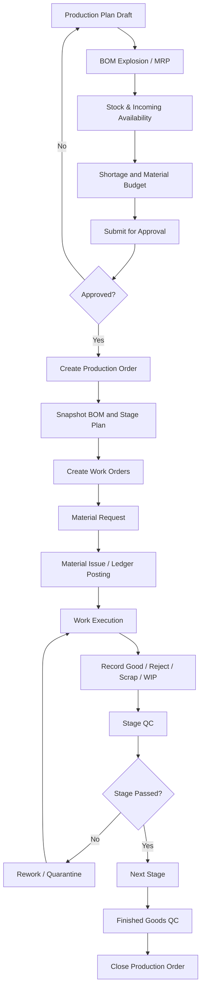
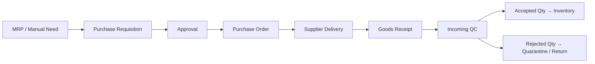
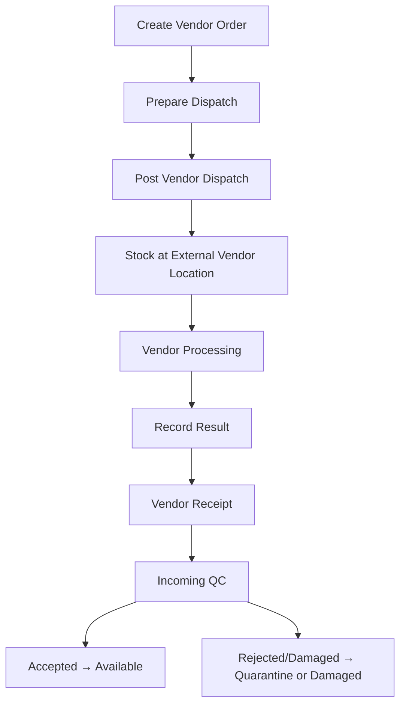

# 03 — Business Process Specification

## 1. Master data setup
1. Create product categories and UOM.
2. Register products/components/modules/boxes/finished goods/programs.
3. Set classification dimensions and tracking method.
4. Configure warehouse and location hierarchy.
5. Register suppliers, GAP/vendor partners, customers, and PICs.
6. Configure BOM versions, stage templates, QC checklists, and document numbering.

## 2. Production planning to completion

### MRP rule
`Net Requirement = max(0, Gross Requirement + Safety Stock - Available Stock - Confirmed Incoming)`.
Available stock is on-hand less active reservations and excludes quarantine/damaged/missing stock. Incoming counts only approved/confirmed supply expected within the planning horizon. Avoid double counting stock already allocated to the same production order.

### Production stage reconciliation
For each stage, reconcile:
`Input Qty = Good Output + Reject Qty + Scrap Qty + WIP Remaining + Approved Process Loss`.
No unexplained variance may be silently discarded. A production order cannot be closed while material/WIP reconciliation or mandatory QC is incomplete.

## 3. Procurement

- PO can be received in multiple receipts.
- PO quantity, received quantity, rejected quantity, and outstanding quantity remain separately visible.
- Purchase price snapshot is stored on PO line; actual receipt price is stored on receipt line.

## 4. GAP/vendor processing

Example: 50 units dispatched; vendor reports 45 completed, 3 outstanding, 2 damaged. The 45 received are physically received and inspected; 3 remain at vendor; 2 are recorded as damaged according to actual physical disposition. Never mark all 50 as returned just because the vendor reports completion.

## 5. Rental / loan
1. Create order and customer/project association.
2. Select serialized box/unit and validate availability for date range.
3. Reserve unit and capture expected kit composition.
4. Generate handover/DO document.
5. Dispatch: move unit to customer/in-transit status.
6. Receive return: capture actual return date and condition.
7. Run checklist against expected box/module/component contents.
8. Missing/damaged items create discrepancy records and QC disposition.
9. Repair or replace components as necessary.
10. Release unit to available only after QC passes.

## 6. Distribution
- Demand source may be sales, project, internal issue, or rental.
- Pick list reserves stock.
- Dispatch posts stock movement to IN_TRANSIT/customer destination.
- Proof of delivery closes shipment; undelivered/returned quantities are reconciled.

## 7. Inventory adjustment and stock opname
- Opname session freezes or snapshots counted scope.
- Count by location/item/serial/batch.
- Variance report compares physical count to system book quantity.
- Adjustment requires reason and approval according to policy.
- Post adjustment as ledger transaction; never edit previous ledger rows.

## 8. Cost calculation
- Material cost uses actual posted material issues.
- Return of unused material creates linked return transaction and reverses associated consumption cost.
- Scrap/reject consumption remains a cost of the production order.
- Cost per good unit = total net material cost / accepted good output quantity.
- If accepted good output is zero, cost per good unit is null/not meaningful; show total cost and zero yield.
