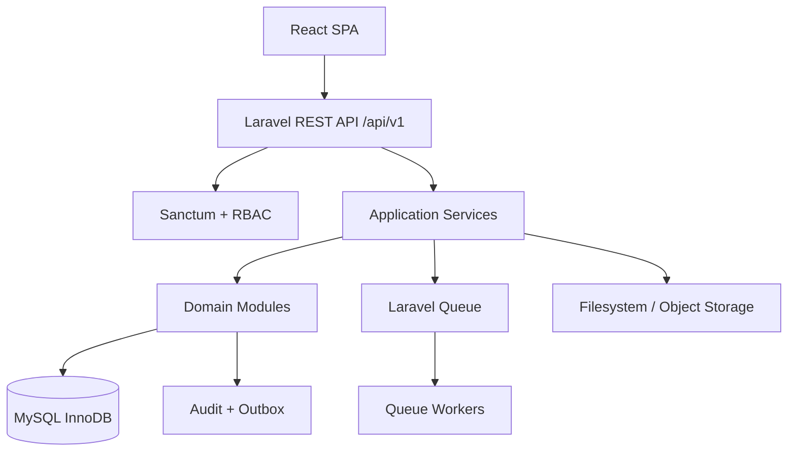

# 04 — System Architecture

## 1. Architecture style
Use a **Modular Monolith**. One deployable Laravel application with clear domain boundaries, shared infrastructure, and explicit module contracts. Do not split into microservices in the initial release.

## 2. High-level components


## 3. Backend domain structure
```text
app/
  Domains/
    MasterData/
    Procurement/
    Production/
    Inventory/
    Warehouse/
    QualityControl/
    VendorManagement/
    Rental/
    Distribution/
    MaterialCost/
    Reporting/
    Administration/
  Shared/
    Approvals/
    Audit/
    Barcode/
    Documents/
    Inventory/
    Notifications/
    Numbering/
  Http/
    Controllers/Api/V1/
    Requests/
    Resources/
    Middleware/
  Providers/
```
Each domain may contain Models, Actions/Services, Policies, DTOs, Events, Listeners, Enums, and Tests. Avoid one giant service class or generic repository abstraction without a clear need.

## 4. Frontend structure
```text
src/
  app/                 # router, providers, app shell
  api/                 # typed API client, interceptors
  components/          # reusable UI
  features/
    dashboard/
    master-data/
    bom/
    procurement/
    production-planning/
    production-execution/
    inventory/
    warehouse/
    quality-control/
    vendor-management/
    rental/
    distribution/
    material-cost/
    reports/
    administration/
  hooks/
  layouts/
  lib/
  routes/
  types/
```
Use feature-based organization. Keep API calls out of presentation components; use feature service/hooks. Centralize form validation, error mapping, permission checks, and table filtering.

## 5. Inventory engine (critical shared domain)
All stock-changing modules call one inventory posting service. No controller, model observer, or feature module may directly update `inventory_balances` or create ledger rows independently.

Responsibilities:
- Validate item tracking method and dimensions.
- Lock affected balance rows using `SELECT ... FOR UPDATE`.
- Validate available quantity and serial/batch status.
- Write inventory transaction header and lines.
- Update balance projection atomically.
- Write cost snapshot/layer values.
- Store idempotency key and audit reference.
- Emit domain event only after successful commit (transactional outbox recommended).

## 6. Data integrity patterns
- InnoDB transactions for all posting operations.
- Row locks for concurrent stock operations.
- Unique constraints for document numbers, product codes, serial numbers, barcodes, and idempotency keys.
- Foreign keys for core business relationships.
- Decimal quantities (`DECIMAL(18,4)`), currency (`DECIMAL(18,2)`), unit cost (`DECIMAL(18,6)`).
- Posted documents are immutable; correction via reversal document.
- Use optimistic versioning for editable drafts if concurrent editing is likely.
- Store timestamps UTC; app display timezone configurable.

## 7. API conventions
- JSON REST under `/api/v1`.
- Resource naming plural and consistent.
- Use Form Requests for validation, Policies for authorization, API Resources for response shape.
- Consistent error envelope and pagination metadata.
- Explicit action endpoints for lifecycle transitions (`submit`, `approve`, `release`, `post`, `reverse`, `close`).
- Never allow arbitrary status patching.

## 8. Queue and files
Use queues for exports, bulk imports, large report generation, notifications, and document rendering. Queue jobs must be idempotent where retried. Store file metadata in DB; use private storage for internal documents. Validate MIME, size, and authorization before download.

## 9. Security
- Sanctum authentication.
- RBAC plus resource-level policies.
- Rate limit authentication and sensitive endpoints.
- Validate uploads and escape rendered user content.
- Secrets only in server environment; never commit `.env`.
- Log security-sensitive events without logging tokens/passwords.
