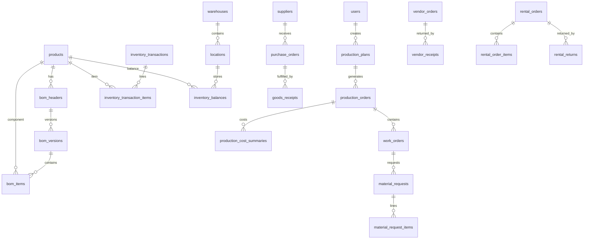

# 05 — Database Schema (Logical + Implementation Baseline)

## 1. Conventions
- MySQL 8+, InnoDB, utf8mb4.
- Primary key: `BIGINT UNSIGNED` auto-increment unless UUID is justified for public identifiers.
- `created_at`, `updated_at`; soft deletes only for master/draft records where appropriate.
- Quantities `DECIMAL(18,4)`, currency `DECIMAL(18,2)`, unit cost `DECIMAL(18,6)`.
- All transactional tables include document number, status, creator, and timestamps as applicable.
- Use explicit foreign keys for core relationships. Avoid polymorphic references for inventory, procurement, production, and rental core flows.
- Use `is_active`/status; do not physically delete records referenced by transactions.

## 2. Entity relationship overview

## 3. Identity, authorization, and audit
### `users`
`id, name, email UNIQUE, password, is_active, last_login_at, timestamps`
### `roles`
`id, code UNIQUE, name, description`
### `permissions`
`id, code UNIQUE, name, module`
### `role_user`
`user_id, role_id` composite unique.
### `permission_role`
`permission_id, role_id` composite unique.
### `audit_logs`
`id, user_id NULL, action, entity_type, entity_id, before_json, after_json, ip_address, user_agent, created_at`
### `document_sequences`
`id, document_type, prefix, date_format, reset_period, last_number, UNIQUE(document_type, reset_period)`.
### `idempotency_keys`
`id, key UNIQUE, operation, request_hash, response_json NULL, user_id, created_at, expires_at`.
### `outbox_events`
`id, event_uuid UNIQUE, aggregate_type, aggregate_id, event_type, payload_json, occurred_at, processed_at NULL, attempts`.

## 4. Master data
### `product_categories`
`id, parent_id NULL, code UNIQUE, name, description, is_active`
### `products`
`id, code UNIQUE, legacy_code NULL, name, description, category_id, product_type ENUM(PRODUCT,SERVICE,PROGRAM), physical_type ENUM(PHYSICAL,DIGITAL,NON_INVENTORY), fulfillment_type ENUM(SELL,RENTAL,INTERNAL,MIXED), tracking_method ENUM(QUANTITY,SERIALIZED,BATCH,NONE), base_uom_id, is_manufactured, is_purchasable, is_sellable, is_rentable, status`
### `product_components`
`id, parent_product_id, component_product_id, quantity, uom_id, effective_from, effective_until NULL, component_role`
For program/bundle composition, supports both service and physical goods.
### `product_prices`
`id, product_id, price_type, amount, currency_code, channel_id NULL, effective_from, effective_until NULL`.
### `product_status_histories`
`id, product_id, business_year, status, notes, changed_by`.
### `uoms`
`id, code UNIQUE, name, dimension`
### `uom_conversions`
`id, from_uom_id, to_uom_id, factor DECIMAL(18,8)`.
### `product_barcodes`
`id, product_id, barcode UNIQUE, barcode_type, is_primary`.
### `product_serials`
`id, product_id, serial_number UNIQUE, barcode UNIQUE NULL, current_location_id NULL, current_status, acquisition_cost NULL, acquired_at NULL`.
### `product_batches`
`id, product_id, batch_number, manufactured_at NULL, expiry_at NULL, UNIQUE(product_id,batch_number)`.
### `customers`
`id, code UNIQUE, name, customer_type, school_name NULL, contact_name NULL, phone NULL, email NULL, address_json NULL, is_active`.
### `suppliers`
`id, code UNIQUE, name, contact_name, phone, email, address_json, is_active`.
### `vendors`
`id, code UNIQUE, name, vendor_type, contact_name, phone, address_json, is_active`.
### `employees`
`id, user_id NULL, employee_code UNIQUE, name, department, is_active`.
### `channels`, `education_levels`, `class_levels`, `program_types`
Lookup tables for catalog attributes; avoid SD/SMP/SMA/Guru/Umum boolean columns.

## 5. Warehouse and inventory
### `warehouses`
`id, code UNIQUE, name, warehouse_type, address, is_active`
### `locations`
`id, warehouse_id, parent_id NULL, code, name, location_type, is_external BOOLEAN, is_active, UNIQUE(warehouse_id,code)`
Supports building/floor/room/rack/bin and external vendor/customer locations.
### `inventory_balances`
`id, product_id, location_id, batch_id NULL, product_serial_id NULL, stock_status, on_hand_qty, reserved_qty, avg_unit_cost, row_version, UNIQUE(product_id,location_id,batch_id,product_serial_id,stock_status)`
Implementation note: MySQL treats NULLs as distinct in unique indexes. Implement normalized dimension keys or generated nullable-safe columns to enforce one balance row per logical dimension. Serialized balances have quantity 1 or 0 and one active location/status.
### `inventory_transactions`
`id, document_no UNIQUE, transaction_type, status(DRAFT,POSTED,REVERSED), transaction_date, source_document_type, source_document_id, idempotency_key UNIQUE, posted_by NULL, posted_at NULL, reversed_transaction_id NULL, notes`
### `inventory_transaction_items`
`id, inventory_transaction_id, product_id, from_location_id NULL, to_location_id NULL, batch_id NULL, product_serial_id NULL, stock_status_from NULL, stock_status_to NULL, quantity, unit_cost NULL, total_cost NULL`
Use signed direction or explicit from/to semantics consistently; do not mix both models.
### `inventory_reservations`
`id, reservation_no, source_type, source_id, product_id, location_id, batch_id NULL, product_serial_id NULL, quantity, status(ACTIVE,PARTIAL,RELEASED,CONSUMED,EXPIRED), expires_at NULL`.
### `stock_opnames`
`id, opname_no UNIQUE, warehouse_id, status, started_at, closed_at, created_by, approved_by NULL`
### `stock_opname_items`
`id, stock_opname_id, location_id, product_id, batch_id NULL, product_serial_id NULL, book_qty, counted_qty NULL, variance_qty NULL, reason NULL`.
### `stock_adjustments`
`id, adjustment_no UNIQUE, stock_opname_id NULL, reason, status, approved_by NULL, posted_transaction_id NULL`.

## 6. BOM and production
### `production_stage_templates`
`id, code UNIQUE, name, product_scope, is_active`
### `production_stage_template_items`
`id, stage_template_id, sequence, stage_code, name, output_product_id NULL, qc_required, UNIQUE(stage_template_id,sequence)`.
### `bom_headers`
`id, code UNIQUE, product_id, name, bom_type(STANDARD_MLK,FLEXIBLE), stage_template_id NULL, status`.
### `bom_versions`
`id, bom_header_id, version_no, status(DRAFT,REVIEW,ACTIVE,RETIRED), effective_from, effective_until NULL, approved_by NULL, approved_at NULL, UNIQUE(bom_header_id,version_no)`.
### `bom_items`
`id, bom_version_id, parent_bom_item_id NULL, component_product_id, item_type(COMPONENT,SUBASSEMBLY), quantity, uom_id, scrap_rate, sequence, notes`.
### `bom_item_alternatives`
`id, bom_item_id, alternative_product_id, conversion_factor, requires_approval`.
### `bom_stage_mappings`
`id, bom_version_id, stage_template_item_id, input_product_id NULL, output_product_id NULL, sequence`.
### `production_plans`
`id, plan_no UNIQUE, title, plan_date, due_date, priority, status(DRAFT,SUBMITTED,APPROVED,REJECTED,CANCELLED), customer_id NULL, project_name NULL, created_by, approved_by NULL, notes`.
### `production_plan_items`
`id, production_plan_id, product_id, target_qty, uom_id, due_date NULL, notes`.
### `production_mrp_runs`
`id, production_plan_id, run_no, status, calculated_at, parameters_json, summary_json`.
### `production_mrp_items`
`id, mrp_run_id, product_id, gross_requirement, available_qty, reserved_qty, confirmed_incoming_qty, safety_stock_qty, net_requirement, suggested_purchase_qty`.
### `production_orders`
`id, order_no UNIQUE, production_plan_item_id, product_id, target_qty, bom_version_id, bom_snapshot_json, stage_snapshot_json, status(PLANNED,RELEASED,IN_PROGRESS,ON_HOLD,COMPLETED,CLOSED,CANCELLED), planned_start, planned_end, actual_start NULL, actual_end NULL, released_by NULL, released_at NULL`.
### `work_orders`
`id, work_order_no UNIQUE, production_order_id, stage_code, stage_name, sequence, target_qty, status, assigned_to NULL, started_at NULL, completed_at NULL, notes`.
### `material_requests`
`id, request_no UNIQUE, work_order_id, requested_by, status(DRAFT,SUBMITTED,APPROVED,PARTIAL,FULFILLED,REJECTED,CANCELLED)`.
### `material_request_items`
`id, material_request_id, product_id, requested_qty, approved_qty, issued_qty, uom_id, notes`.
### `material_issues`
`id, issue_no UNIQUE, material_request_id, issued_by, status, inventory_transaction_id NULL, issued_at NULL`.
### `material_issue_items`
`id, material_issue_id, product_id, location_id, batch_id NULL, product_serial_id NULL, issued_qty, returned_unused_qty DEFAULT 0, unit_cost NULL, total_cost NULL`.
### `production_results`
`id, work_order_id, result_date, input_qty, good_qty, reject_qty, scrap_qty, wip_remaining_qty, approved_process_loss_qty, recorded_by, notes`.
### `production_result_items`
`id, production_result_id, output_product_id, quantity, result_type(GOOD,REJECT,SCRAP,WIP), location_id NULL`.
### `production_waste_records`
`id, production_order_id, work_order_id NULL, product_id, quantity, waste_type, reason, disposition, recorded_by`.
### `production_cost_summaries`
`id, production_order_id UNIQUE, total_material_cost, total_good_qty, total_reject_qty, material_cost_per_good_unit NULL, calculated_at`.
### `production_cost_items`
`id, production_order_id, work_order_id NULL, product_id, actual_quantity, unit_cost, total_cost, inventory_transaction_item_id UNIQUE`.

## 7. Procurement
### `purchase_requisitions`
`id, pr_no UNIQUE, requested_by, status, needed_by, justification`.
### `purchase_requisition_items`
`id, purchase_requisition_id, product_id, quantity, uom_id, estimated_unit_price NULL`.
### `purchase_orders`
`id, po_no UNIQUE, supplier_id, order_date, expected_date NULL, status, currency_code, subtotal, notes`.
### `purchase_order_items`
`id, purchase_order_id, product_id, ordered_qty, received_qty, unit_price, discount_amount, tax_amount, uom_id`.
### `goods_receipts`
`id, grn_no UNIQUE, purchase_order_id, received_at, received_by, status, inventory_transaction_id NULL`.
### `goods_receipt_items`
`id, goods_receipt_id, purchase_order_item_id, received_qty, accepted_qty, rejected_qty, actual_unit_price, batch_id NULL, notes`.
### `purchase_cost_histories`
`id, product_id, supplier_id NULL, purchase_order_item_id NULL, goods_receipt_item_id NULL, unit_price, currency_code, effective_at`.

## 8. Vendor/GAP processing and shipment
### `vendor_orders`
`id, vendor_order_no UNIQUE, vendor_id, processing_type, warehouse_id, expected_return_date NULL, status, created_by`.
### `vendor_order_items`
`id, vendor_order_id, product_id, sent_quantity, completed_quantity, outstanding_quantity, damaged_quantity, uom_id`.
### `vendor_receipts`
`id, receipt_no UNIQUE, vendor_order_id, received_by, received_at, receipt_status, inventory_transaction_id NULL`.
### `vendor_receipt_items`
`id, vendor_receipt_id, vendor_order_item_id, received_quantity, accepted_quantity, rejected_quantity, outstanding_quantity, notes`.
### `shipments`
`id, shipment_no UNIQUE, shipment_type, source_location_id, destination_location_id, source_document_type, source_document_id, status, dispatched_at NULL, delivered_at NULL, tracking_reference NULL`.
### `shipment_items`
`id, shipment_id, product_id, quantity, batch_id NULL, product_serial_id NULL`.

## 9. Rental, loan, QC, and repair
### `rental_orders`
`id, rental_no UNIQUE, transaction_kind(RENTAL,LOAN), customer_id, project_name NULL, group_leader NULL, sales_pic NULL, start_date, expected_return_date, status, notes`.
### `rental_order_items`
`id, rental_order_id, product_id, product_serial_id NULL, quantity, expected_contents_json, dispatched_qty, returned_qty`.
### `rental_returns`
`id, return_no UNIQUE, rental_order_id, received_by, returned_at, status`.
### `rental_return_items`
`id, rental_return_id, rental_order_item_id, product_id, product_serial_id NULL, expected_qty, actual_qty, missing_qty, damaged_qty, condition_notes`.
### `quality_inspections`
`id, inspection_no UNIQUE, inspection_type, source_document_type, source_document_id, product_id NULL, inspected_by, inspected_at, status(PENDING,PASSED,FAILED,CONDITIONAL), notes`.
### `quality_inspection_items`
`id, quality_inspection_id, checklist_code, description, expected_value NULL, actual_value NULL, result(PASS,FAIL,NA), notes`.
### `quality_discrepancies`
`id, quality_inspection_id, product_id, discrepancy_type(MISSING,DAMAGED,EXCESS,WRONG_ITEM), quantity, reference_unit_price NULL, estimated_claim_amount NULL, resolution_status`.
### `repair_orders`
`id, repair_no UNIQUE, product_serial_id NULL, product_id, source_inspection_id NULL, status, assigned_to NULL, opened_at, closed_at NULL, repair_notes`.
### `repair_order_items`
`id, repair_order_id, component_product_id, quantity, disposition`.

## 10. Documents, approvals, attachments
### `approval_requests`
`id, document_type, document_id, approval_step, requested_by, approver_id NULL, status, decision_at NULL, comments`.
### `document_templates`
`id, code UNIQUE, name, document_type, template_body, version, is_active`.
### `generated_documents`
`id, document_type, document_no, source_type, source_id, file_path, generated_by, generated_at`.
### `attachments`
`id, owner_type, owner_id, file_name, file_path, mime_type, file_size, uploaded_by, created_at`.
For critical business documents, prefer explicit FK tables over polymorphic attachments if stronger referential integrity is required.

## 11. Database implementation notes
- The above is a logical schema, not a mandate to create every table in one migration. Implement by domain and dependencies.
- Use lookup tables instead of free-text for statuses/types where admins should not configure values; use PHP backed enums for controlled state.
- For unique indexes containing nullable dimensions, account for MySQL NULL uniqueness behavior.
- Never cascade-delete posted transactional records.
- Add indexes for all foreign keys, document numbers, status/date search, product/location, source references, and ledger chronology.
- Add check constraints where supported, and enforce critical rules in domain services too.
- Use decimal arithmetic; never store quantities or money as FLOAT/DOUBLE.
